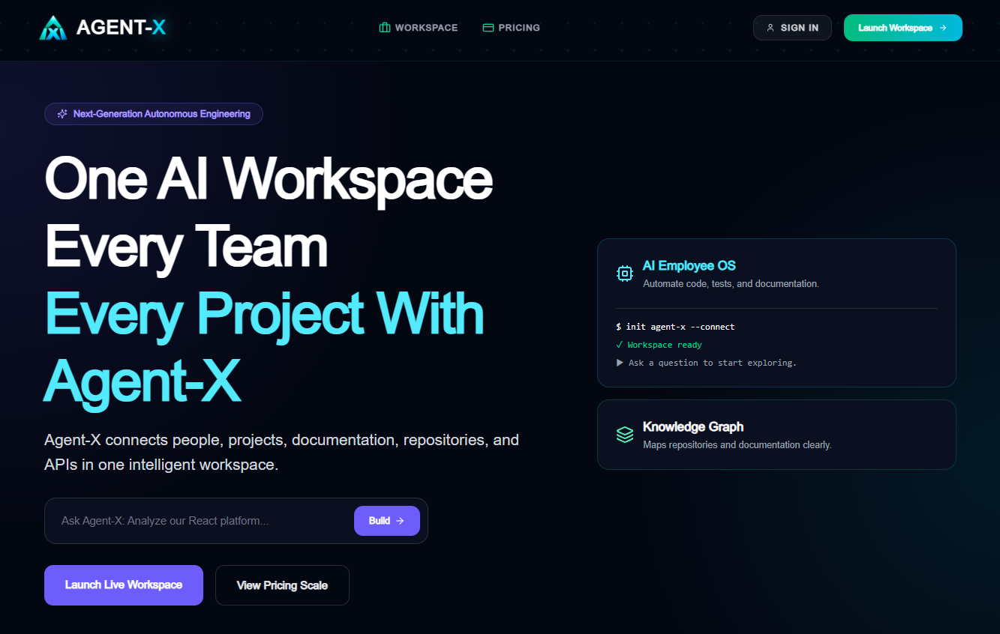
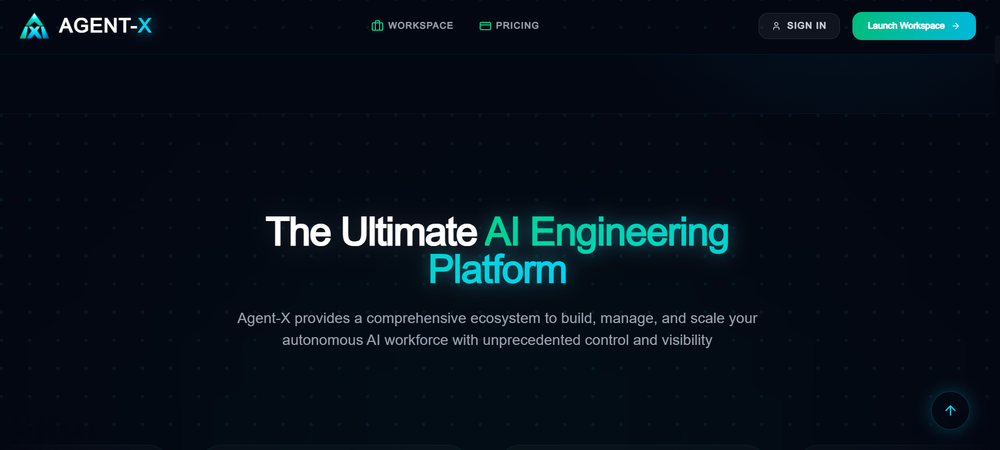
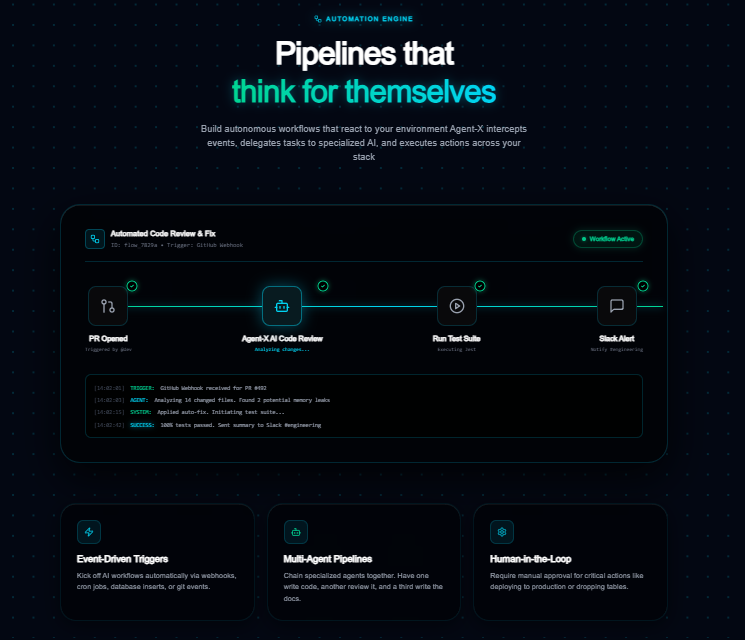
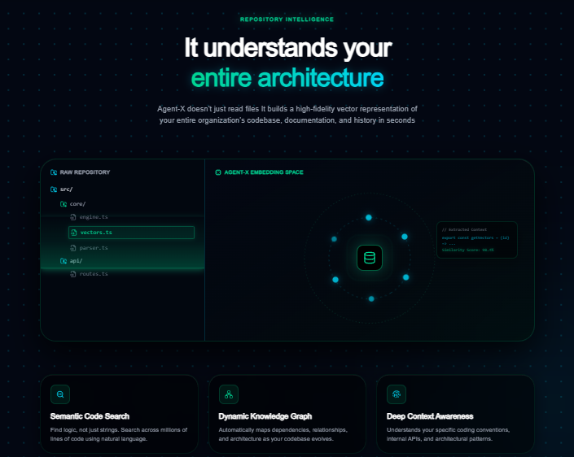
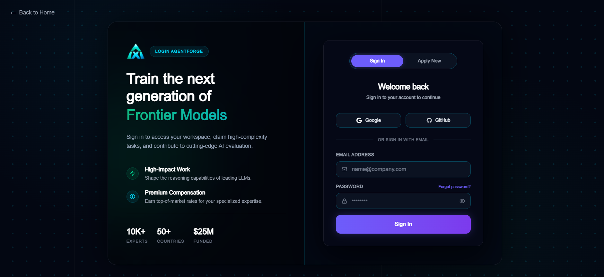
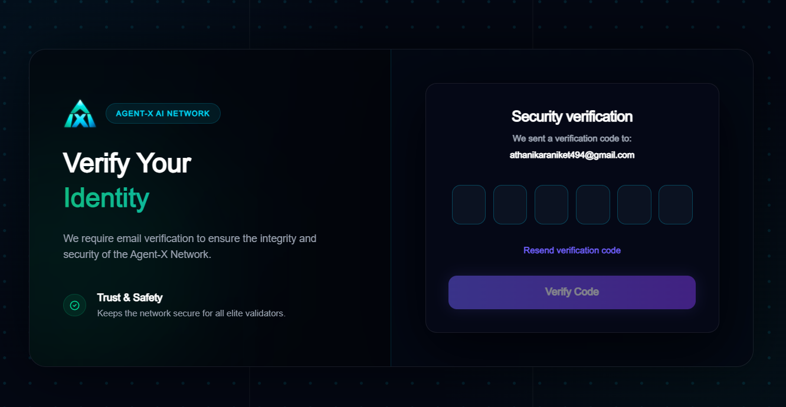
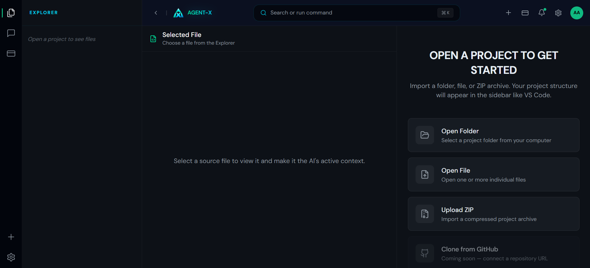
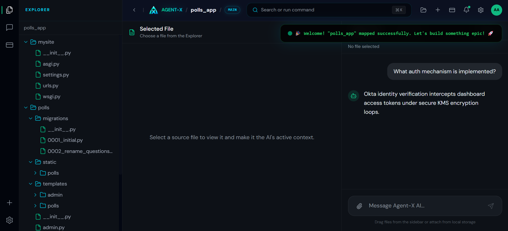
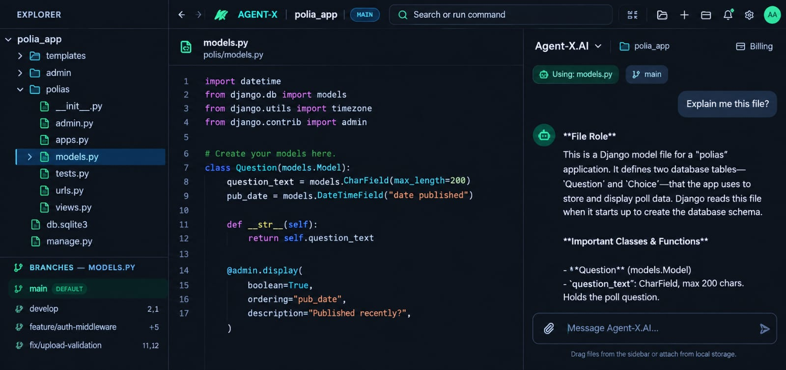

# 🚀 Agent-X

### Enterprise AI Engineering Workspace

> Transform software repositories into searchable, explainable, and intelligent engineering workspaces.

[](https://nextjs.org/)
[](https://react.dev/)
[](https://fastapi.tiangolo.com/)
[](https://www.python.org/)
[](https://www.postgresql.org/)
[](https://redis.io/)
[](https://qdrant.tech/)
[](https://www.docker.com/)
[](#-license)

---

## 📖 Overview

Agent-X is an AI-native engineering workspace built to help developers understand, explore, and work with unfamiliar software repositories.

Large repositories can contain thousands of files, multiple services, undocumented business logic, configuration files, dependencies, and legacy code. Finding the right file is often only the beginning — understanding what that code actually does is the difficult part.

Agent-X brings repository exploration and AI assistance into a single developer-focused workspace.

Instead of treating the repository as a collection of isolated files, Agent-X is designed to build context around the project and use that context to provide meaningful engineering assistance.

### Agent-X can help developers:

* Explore repository structures
* Understand unfamiliar files and modules
* Ask questions about project code
* Search repositories using semantic context
* Explain code in simple language
* Understand relationships between files
* Generate technical documentation
* Analyze architecture
* Assist with testing and code review
* Build persistent repository knowledge

---

# 🎯 Vision

The goal of Agent-X is simple:

> Make unfamiliar software easier to understand.

A developer should be able to open a repository and ask:

```text
"What does this project do?"

"Explain this file to me."

"Where is authentication implemented?"

"How does a user registration request work?"

"What happens when this API endpoint is called?"

"Which files are responsible for database access?"

"Explain this HTML page like I'm new to frontend development."

"Show me how these modules are connected."
```

Agent-X is designed to turn those questions into contextual engineering assistance.

---

# ✨ Core Capabilities

## 🗂 Repository Intelligence

Agent-X analyzes repository structures to provide a deeper understanding of software projects.

* Repository scanning
* Folder and file exploration
* File-type detection
* Source-code extraction
* Symbol discovery
* Import analysis
* Dependency analysis
* Project structure analysis
* Code relationships
* Repository context building

Supported content can include programming languages, configuration files, markup, stylesheets, documentation, and common project files.

---

## 🧠 AI-Powered Code Understanding

The workspace allows developers to select files and ask questions about their actual contents.

For example:

```text
Explain this file.

How does this function work?

Explain this code line by line.

What happens when this API is called?

Why is this class required?

Find the potential bug in this code.

How does this component communicate with the backend?
```

Agent-X is designed to explain code progressively:

```text
Concept
   ↓
What the code is doing
   ↓
How the important logic works
   ↓
Technical implementation
   ↓
Example / flow
```

The objective is not simply to summarize source code, but to help developers build a mental model of how it works.

---

# 🔎 Semantic Repository Search

Traditional search requires developers to know what they are looking for.

Agent-X uses repository context and semantic retrieval to help locate relevant information.

For example:

```text
"Where is password reset implemented?"
```

can lead to relevant authentication files even when the exact words used in the question do not appear in the filename.

The repository knowledge layer is designed around:

* Document chunking
* Embeddings
* Semantic search
* Vector retrieval
* Context ranking
* Repository-aware generation

---

# 🤖 AI Engineering Workspace

Agent-X provides a developer workspace combining repository navigation with contextual AI assistance.

```text
┌──────────────────────────────────────────────────────────┐
│                      Agent-X Workspace                    │
├───────────────┬────────────────────────┬─────────────────┤
│               │                        │                 │
│ Repository    │      Code / File       │    AI Chat      │
│ Explorer      │        Viewer          │                 │
│               │                        │                 │
│ 📁 backend    │  selected_file.py     │  Ask Agent-X    │
│ 📁 frontend   │                        │                 │
│ 📄 README     │  source code           │  Explain this   │
│ 📄 config     │                        │  file           │
│               │                        │                 │
└───────────────┴────────────────────────┴─────────────────┘
```

The selected file can become the primary context for the AI interaction while repository-level context can provide additional information when required.

---

# 🧩 Engineering Workflows

Agent-X is designed as an extensible platform rather than a single-purpose chatbot.

### Repository Understanding

* Repository exploration
* File explanations
* Dependency discovery
* Code relationships
* Project architecture understanding

### Documentation

* README assistance
* API documentation
* Module explanations
* Function and class explanations
* Architecture documentation

### Code Review

Planned capabilities include:

* Pull request analysis
* Bug detection assistance
* Performance analysis
* Security-oriented checks
* Engineering recommendations

### Testing

Planned capabilities include:

* Unit test generation
* Integration test assistance
* Edge-case discovery
* Test improvement
* Mock generation

### Architecture

Planned capabilities include:

* Architecture visualization
* Service relationship analysis
* Dependency graphs
* Design-pattern discovery
* System-level repository exploration

---

# 🧠 AI Architecture

Agent-X combines retrieval, orchestration, repository context, and language models.

```text
                   User
                    │
                    ▼
            ┌───────────────┐
            │  Agent-X UI   │
            │   Next.js     │
            └───────┬───────┘
                    │
                    ▼
            ┌───────────────┐
            │   FastAPI     │
            │   API Layer   │
            └───────┬───────┘
                    │
          ┌─────────┴─────────┐
          │                   │
          ▼                   ▼
   ┌─────────────┐     ┌─────────────┐
   │ Repository  │     │ AI Workflow │
   │ Processing  │     │ Orchestration│
   └──────┬──────┘     └──────┬──────┘
          │                   │
          ▼                   ▼
   ┌─────────────┐     ┌─────────────┐
   │ Chunking &  │     │ LLM Provider│
   │ Embeddings  │     │             │
   └──────┬──────┘     └─────────────┘
          │
          ▼
   ┌─────────────┐
   │   Qdrant    │
   │ Vector Store│
   └─────────────┘

          PostgreSQL
              │
              ▼
      Application Data

           Redis
              │
              ▼
       Cache / Jobs
```

---

# 🔐 Authentication & Security

Agent-X includes authentication and access-control infrastructure for protected workspaces.

Current capabilities include:

* JWT authentication
* Email verification
* OTP verification
* Password reset
* Protected API endpoints
* Role-based access control
* Secure session handling
* Account management

---

# 📧 Email Infrastructure

Agent-X includes email workflows for account-related operations.

* OTP emails
* Email verification
* Password reset
* HTML email templates
* Product-branded email communication

---

# 📊 Usage & Execution Tracking

Agent-X is designed with server-side execution tracking to make AI usage measurable and auditable.

The planned usage layer includes:

* AI execution IDs
* Per-user usage limits
* Token consumption tracking
* Input/output token accounting
* Provider and model tracking
* Execution duration
* Success/failure status
* Retrieval information
* Workspace context
* Audit records

This provides the foundation for future engineering analytics and usage dashboards.

---

# 🖥️ Product Showcase

## 🌐 Landing Page

The Agent-X landing page introduces the platform, repository intelligence workflow, AI engineering capabilities, and developer-focused workspace.

<p align="center">
  
</p>

<p align="center">
  
</p>

<p align="center">
  
</p>

<p align="center">
  
</p>

---

## 🔐 Authentication

Agent-X includes a protected authentication flow with email verification and OTP-based verification.

### Login

<p align="center">
  
</p>

### OTP Verification

<p align="center">
  
</p>

---

## 🧠 Agent-X Workspace

The Agent-X workspace combines repository exploration, source-code inspection, and contextual AI assistance.

### 1. Repository Selection

Select the folder or repository that should be analyzed.

<p align="center">
  
</p>

### 2. Project Structure

After selecting the repository, Agent-X analyzes the project and presents its structure through the workspace explorer.

<p align="center">
  
</p>

### 3. AI Engineering Workspace

Select a file, inspect its source code, and interact with Agent-X using contextual AI assistance.

<p align="center">
  
</p>

> Screenshots can be placed in the repository's `frontend/public/` directory and referenced directly from the README.

---

# 💎 Product Experience

Agent-X is designed around a familiar developer workflow.

### Repository Explorer

Navigate through folders and files without leaving the AI workspace.

### Context-Aware AI

Ask questions about the selected file or broader repository context.

### Code Understanding

Understand unfamiliar source code without needing to manually trace every file.

### Developer-Oriented Interface

The workspace follows familiar IDE concepts while keeping AI assistance directly beside the source code.

### Progressive Explanation

Agent-X aims to explain technical concepts in a way that works for both experienced developers and developers learning an unfamiliar codebase.

---

# 📂 Repository Intelligence

The repository intelligence layer is designed to operate across multiple levels.

```text
Repository
    │
    ├── Project Structure
    │
    ├── Directories
    │
    ├── Files
    │
    ├── Classes
    │
    ├── Functions
    │
    ├── Imports
    │
    └── Dependencies
             │
             ▼
       Repository Context
             │
             ▼
          AI Workspace
```

This creates a foundation for understanding not only individual files, but also relationships across the project.

---

# 🛠️ Technology Stack

## Frontend

* Next.js 15
* React 19
* Tailwind CSS
* Redux Toolkit
* Framer Motion
* Three.js

## Backend

* FastAPI
* Python 3.11+
* SQLAlchemy
* Uvicorn
* Pydantic
* FastAPI-Mail
* JWT Authentication

## AI / RAG

* LangGraph
* LangChain
* Ollama / External LLM Providers
* SentenceTransformers
* Qdrant
* Retrieval-Augmented Generation
* Vector Embeddings
* Semantic Retrieval

## Data

* PostgreSQL
* Redis
* Qdrant

## Infrastructure

* Docker
* Docker Compose
* Nginx
* GitHub Actions
* Linux
* Windows

---

# 🏗️ Project Structure

```text
Agent-X/
│
├── backend/
│   ├── app/
│   │   ├── api/
│   │   ├── core/
│   │   ├── database/
│   │   ├── modules/
│   │   ├── services/
│   │   └── main.py
│   │
│   ├── tests/
│   ├── requirements.txt
│   └── Dockerfile
│
├── frontend/
│   ├── public/
│   ├── src/
│   │   ├── app/
│   │   ├── components/
│   │   ├── dashboard/
│   │   ├── landing/
│   │   └── services/
│   │
│   ├── package.json
│   └── Dockerfile
│
├── nginx/
│   └── nginx.conf
│
├── docker-compose.yml
├── README.md
├── LICENSE
└── .gitignore
```

---

# 🚀 Quick Start

## Clone

```bash
git clone https://github.com/Aniket-Athanikar/Agent-X.git

cd Agent-X
```

---

# 🐳 Docker Setup

Agent-X uses Docker Compose for the backend infrastructure and supporting services.

Start the services with:

```bash
docker compose up --build
```

The current development setup runs the frontend separately when required.

### Backend

```text
http://localhost:8000
```

### Swagger API Documentation

```text
http://localhost:8000/docs
```

### ReDoc

```text
http://localhost:8000/redoc
```

### Agent-X Development Gateway

When using the Nginx development gateway:

```text
http://localhost:8080
```

---

# 💻 Local Development

## Backend

```bash
cd backend

python -m venv af_env
```

### Windows

```bash
af_env\Scripts\activate
```

Install dependencies:

```bash
pip install -r requirements.txt
```

Start FastAPI:

```bash
python -m uvicorn app.main:app --reload
```

---

## Frontend

```bash
cd frontend

npm install

npm run dev
```

The frontend normally runs on:

```text
http://localhost:3000
```

---

# 🧪 Testing

Backend tests can be executed with:

```bash
cd backend

pytest
```

For a more detailed test output:

```bash
pytest -v
```

---

# 🛣️ Roadmap

Agent-X is being developed toward a broader AI engineering platform.

### Repository Intelligence

* [x] Repository exploration
* [x] File detection
* [x] Multi-language file processing
* [x] Contextual file explanations
* [x] Semantic repository retrieval
* [ ] Advanced dependency graphs
* [ ] Knowledge graph

### AI Engineering

* [x] AI chat
* [x] RAG-based repository context
* [x] AI workflow foundation
* [ ] Advanced multi-agent workflows
* [ ] Agent planning
* [ ] Agent task delegation
* [ ] Long-term project memory

### Developer Workflows

* [ ] GitHub integration
* [ ] Pull request AI review
* [ ] Automated test generation
* [ ] Architecture visualization
* [ ] CI/CD insights
* [ ] Issue analysis

### Enterprise

* [ ] Multi-repository workspaces
* [ ] Team collaboration
* [ ] Enterprise SSO
* [ ] Organization management
* [ ] Advanced audit analytics
* [ ] Role-based enterprise administration

### Future AI Roles

Potential specialized engineering agents include:

* AI Product Manager
* AI Business Analyst
* AI Solution Architect
* AI Backend Engineer
* AI Frontend Engineer
* AI DevOps Engineer
* AI QA Engineer
* AI Security Auditor
* AI Technical Writer

---

# 👨‍💻 Contributors

## Aniket Athanikar

### Primary Engineering & Platform Development

* Backend Engineering
* Frontend Engineering
* AI Systems
* Platform Architecture
* API Development
* Database Integration
* Authentication
* Repository Intelligence
* RAG Workflows
* Infrastructure & Docker
* System Integration

## Mrunal Chaudhari

### Frontend Engineering & UI/UX

* Frontend Development
* UI/UX
* Product Interface
* Frontend Components
* User Experience

---

# 📌 Project Status

Agent-X is an actively developed engineering platform.

The current system focuses on:

```text
Repository
    ↓
Repository Exploration
    ↓
File Understanding
    ↓
Context Retrieval
    ↓
AI Assistance
    ↓
Engineering Workflows
```

The architecture is intentionally being built so additional AI engineering workflows can be introduced without replacing the underlying repository intelligence layer.

---

# ⭐ Support

If you are interested in Agent-X:

* ⭐ Star the repository
* 🐛 Report issues
* 💡 Share feedback
* 📖 Explore the architecture

Please note that the repository is publicly visible for demonstration and reference purposes, but the source code remains proprietary.

---

# 📄 License

Copyright © 2026 Aniket Athanikar. All Rights Reserved.

Agent-X is proprietary software.

The source code is publicly available for viewing and reference purposes only.

Without explicit written permission from the copyright holder, you may not:

* Copy or reproduce the source code
* Modify or adapt the source code
* Create derivative works
* Redistribute or republish the project
* Use substantial portions of the source code in another project
* Sell or commercially exploit the software
* Use Agent-X as the basis for a competing product
* Remove copyright or ownership notices
* Claim the project or derivative work as your own

Accessing or cloning the public repository does not grant permission to use, modify, distribute, or commercially exploit the software.

For licensing or commercial-use inquiries, contact the copyright holder.

---

# 🚀 Agent-X

### Understand. Explore. Engineer.

> Built for the future of AI-assisted software engineering.
